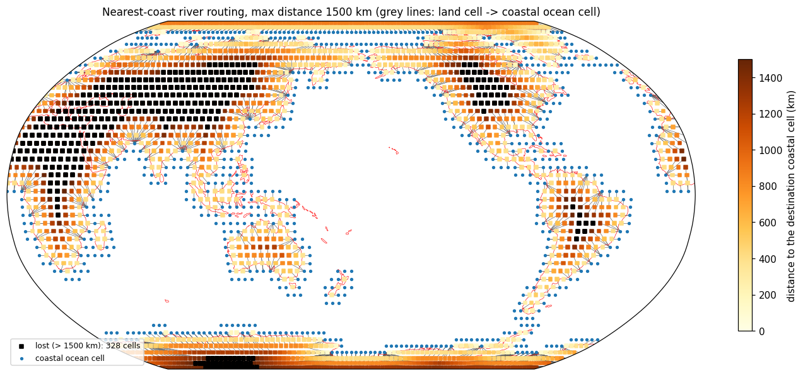

# River-routing map

River routing map product is a matrix multiplication that maps the river runoff to ocean. This idea is basically the same as regridding. Therefore, the river routing map end product is a NetCDF file that can be used by ESMFRegridder ( see `/home/tienyiao/projects_local/project_jax-esm/jem_repo/incorporate-winton-seaice-model/jem/utils/esmf_regrid.py`).

The grids are in `grid_ESM_collocated`. Currently, river routhing map routes between the same grid.

## Usage

    python make_river_routing.py grid_ESM_collocated/ocn_topo_JCM_T31.nc \
        grid_ESM_collocated/JCM_T31.SCRIP.nc weight_river_routing_JCM_T31.nc \
        --max-distance-km 1500 --diagnostics river_routing_JCM_T31.nc --plot figures/river_routing.png

The weight file maps a land flux per unit area (e.g. land P−E in kg m⁻² s⁻¹) to river input per unit area on coastal ocean cells; it is zero elsewhere. Ocean cells and land cells beyond `--max-distance-km` have no entry. Negative values are not clipped. Apply it with `ESMFRegridder("weight_river_routing_JCM_T31.nc")(field)`, where `field` is (n_lon, n_lat). See `AGENTS.md` for details.

## Example

The T31 grid with `--max-distance-km 1500`. Each land cell is coloured by the distance to its coastal ocean cell, and grey lines join each land cell to its destination. Blue dots are coastal ocean cells, and black squares are land cells farther than 1500 km from any coast, whose water is lost (328 of 1980 land cells, 21.5% of the land area).

